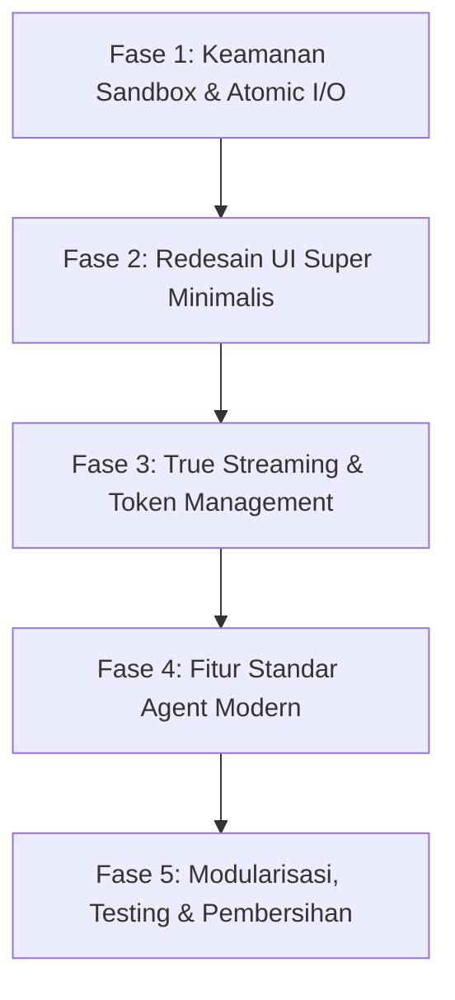

# Rencana Implementasi: Transformasi Standar AI Agent Modern & UI Minimalis
**Proyek:** Gemini Terminal Agent (Indonesiaku-Lang)  
**Tujuan:** Mengatasi temuan audit teknis, mengadopsi standar kemampuan AI Agent modern (seperti Claude Code, Aider, Cursor), dan merampingkan antarmuka (UI) menjadi super minimalis, elegan, dan produktif.

---

## 1. Visi & Filosofi Perubahan

### A. Transformasi Antarmuka (Minimalist & Focused UI)
Saat ini UI memiliki kotak-kotak bertingkat dengan border tebal (*heavy panels*), tombol besar yang memakan ruang vertikal (*3-row button containers*), dan preview tool yang memakan banyak baris.
**Filosofi Baru (Zen Terminal UX):**
- Mengadopsi gaya modern *Claude Code / Aider / NeoVim*: antarmuka bersih tanpa border bertumpuk.
- **Header Kompak (1 baris):** Menggabungkan logo, model, dan sesi aktif secara horizontal ramping.
- **Aliran Percakapan Bersih:** Menghilangkan border box tebal pada pesan; menggantinya dengan penanda tepi (*subtle gutter indicator*) dan tipografi Markdown yang mengalir alami.
- **Kompak Tool Cards (Single Line Collapsible):** Eksekusi tool dirampingkan menjadi 1 baris yang informatif (misal: `⚙ baca_berkas: perkakas.idk (10.8 KB) ✓`), menghemat 70% ruang vertikal layar.
- **Prompt Input Seamless:** Menggabungkan tombol interupsi dan kirim menjadi badge status inline atau shortcut alami tanpa tombol raksasa yang mengikis area pesan.
- **Status Bar Tipis & Kaya Konteks:** Menampilkan status agen, estimasi token sesi, dan pintasan penting dalam 1 baris di bagian paling dasar.

### B. Standardisasi AI Agent Modern
Mengadopsi fitur standar industri yang belum ada:
1. **Penyebutan Konteks Berkas (`@berkas` / `@file` context injection):** Pengguna dapat mengetik `@nama_file` pada prompt, dan agen akan langsung memuat isi file tersebut ke dalam konteks percakapan.
2. **Aturan Proyek Otomatis (`AGENTS.md` / `ATURAN.md`):** Otomatis membaca panduan kustom repositori jika file aturan ditemukan di root proyek.
3. **Pelacak Token & Estimasi Biaya (Live Token Counter):** Menampilkan jumlah token input/output dari API Gemini secara transparan.
4. **Penyuntingan Berkas Berbasis Diff / Patch (`edit_berkas`):** Agen tidak lagi menimpa seluruh file 1000 baris untuk mengubah 2 baris kode, melainkan menggunakan operasi diff/replace cerdas.
5. **Ekspor Percakapan (`/export`):** Menyimpan riwayat chat lengkap ke berkas Markdown yang rapi untuk dokumentasi.
6. **Streaming Token Sejati (*True Server-Sent Streaming*):** Menggunakan `client.models.generate_content_stream()` dari Google GenAI SDK.

---

## 2. Rincian Fase Implementasi



---

### Fase 1: Keamanan Sandbox & Penulisan File Atomik (Security & Stability)
**Tujuan:** Mengamankan lingkungan eksekusi agen dan mencegah korupsi data sesi.

- [ ] **1.1 Workspace Path Jail / Sandbox (`perkakas.idk`)**:
  - Terapkan fungsi `validasi_jalur_sandbox(path)` yang memastikan semua operasi `baca_berkas`, `tulis_berkas`, `buat_folder`, dan `daftar_berkas` hanya beroperasi di dalam direktori kerja root proyek (`Path.cwd()`).
  - Blokir akses ke luar direktori kerja (seperti `../`, path absolut partisi lain, direktori konfigurasi pengguna `~/.ssh`, `~/.bashrc`, dll.) kecuali pengguna memberikan izin eksplisit via konfigurasi.
- [ ] **1.2 Konfirmasi Pengguna untuk Perintah Berisiko (Human-in-the-Loop)**:
  - Buat modal dialog interaktif `KonfirmasiPerintahModal` di `aplikasi.idk`.
  - Jika perintah shell mengandung modifikasi kritis (misal: install dependensi, modifikasi file sistem, operasi git delete/push), minta persetujuan pengguna sebelum mengeksekusi.
- [ ] **1.3 Atomic File Writing (`pengelola_sesi.idk` & `memori.idk`)**:
  - Ganti `target.write_text(...)` dengan pola tulis file sementara (`.tmp`) lalu `os.replace(...)` untuk memastikan file sesi dan memori tidak pernah kosong/korup jika terjadi penghentian mendadak.

---

### Fase 2: Redesain UI Super Minimalis (Sleek Terminal Aesthetic)
**Tujuan:** Memaksimalkan area baca dan meminimaliskan elemen antarmuka yang mengganggu.

- [ ] **2.1 Header Ramping (Single-line Header)**:
  - Ganti header 3 baris menjadi 1 baris ringkas:
    `⌬ GEMINI AGENT ─ gemini-2.5-flash │ Sesi: Analisis Arsitektur │ 14:32:05`
  - Hilangkan border tebal di bawah header; gunakan garis pembatas 1 karakter tipis (`#30363d`).
- [ ] **2.2 Redesain Kotak Pesan Bersih (Borderless Stream)**:
  - Hapus background panel ganda dan border kotak tebal pada chat.
  - Terapkan gaya gutter minimalis:
    - Pesan Pengguna: Gutter warna biru tipis di sisi kiri dengan label `❯ Anda`.
    - Pesan Agen: Gutter hijau/emas tipis dengan tipografi Markdown bersih tanpa frame kotak.
- [ ] **2.3 Single-Line Tool Call Indicator**:
  - Ganti kotak tool call 4-5 baris dengan format baris kompak:
    `  ⚙ [alat] baca_berkas (app.py) ─ Selesai (338 byte)`
  - Sediakan kemampuan expand/collapse jika pengguna ingin melihat output lengkap.
- [ ] **2.4 Prompt Input & Tombol Terintegrasi (Inline Bar)**:
  - Hilangkan tombol fisik besar setinggi 3 baris (`#btn_send` dan `#btn_interrupt`).
  - Ubah area input menjadi baris prompt modern:
    `❯ [ Ketik instruksi atau /help...                   ] [● READY]`
  - Tombol interupsi (`⏹ Hentikan`) tampil sebagai badge merah kecil inline hanya ketika agen sedang memproses (`is_thinking == true`), atau cukup dengan pintasan `Ctrl + X` / `Esc`.
- [ ] **2.5 Status Bar Tipis & Elegan**:
  - 1 baris docked di paling bawah:
    `[⌬ gemini-2.5-flash] [Tokens: 1.2k / 1M] [● READY]  Ctrl+S: Sesi · Ctrl+M: Model · Ctrl+R: Restart · /help`

---

### Fase 3: True Streaming & Manajemen Konteks Cerdas (Engine Streaming)
**Tujuan:** Respons instan seketika token diproduksi dan proteksi terhadap ledakan token.

- [ ] **3.1 Integrasi True Response Streaming (`agen.idk` & `aplikasi.idk`)**:
  - Gunakan `diri.client.models.generate_content_stream()` atau `chat.send_message_stream()`.
  - Pasang callback chunk generator yang mengalirkan setiap potongan teks (*delta chunk*) langsung ke widget markdown Textual secara asynchronous.
  - Waktu tunggu Time to First Token (TTFT) berkurang dari ~5 detik menjadi < 500 ms.
- [ ] **3.2 Context Window & Token Counter Tracker (`agen.idk`)**:
  - Lacak total token input dan output setiap putaran menggunakan `response.usage_metadata`.
  - Simpan dan tampilkan statistik token di status bar.
- [ ] **3.3 Strategi Context Pruning (Sliding History)**:
  - Batasi riwayat interaksi aktif (misalnya maksimal 30 putaran percakapan atau 80.000 token).
  - Ketika melampaui batas, pangkas putaran tengah secara halus atau buat ringkasan otomatis (*auto-summarization turn*), sembari menjaga system instruction dan pesan terbaru tetap utuh.

---

### Fase 4: Penambahan Fitur Standar AI Agent Modern
**Tujuan:** Menghadirkan kemampuan AI Coding Agent kelas dunia ke dalam antarmuka terminal.

- [ ] **4.1 Injeksi Konteks Cepat dengan `@berkas` / `@file`**:
  - Parser input otomatis mendeteksi kata berawalan `@nama_file` (misal `@app.py`, `@README.md`).
  - Secara otomatis membaca file tersebut dan melampirkannya sebagai konteks prompt sebelum dikirim ke Gemini.
- [ ] **4.2 Aturan Proyek Otomatis (`AGENTS.md` / `ATURAN.md`)**:
  - Saat startup atau inisialisasi sesi, periksa apakah file `AGENTS.md` atau `.agentrules` ada di direktori kerja.
  - Jika ada, gabungkan isinya ke dalam `system_instruction` agen agar agen selalu memahami konvensi koding lokal repositori pengguna.
- [ ] **4.3 Tool Pengeditan File Pintar (`replace_file_content` / diff editing)**:
  - Tambahkan tool baru `edit_berkas(path, target_text, replacement_text)` di `perkakas.idk`.
  - Agen tidak perlu menimpa 500 baris file hanya untuk mengganti satu fungsi, sehingga menghemat kuota output token hingga 90% dan meminimalkan galat penulisan.
- [ ] **4.4 Perintah Ekspor Sesi (`/export [nama.md]`)**:
  - Menambahkan perintah `/export` untuk mengekspor percakapan aktif ke format Markdown yang rapi dan siap dibagikan.

---

### Fase 5: Modularisasi, Testing & Pembersihan Repositori
**Tujuan:** Menjamin kemudahan pemeliharaan jangka panjang (*maintainability*).

- [ ] **5.1 Modularisasi `aplikasi.idk`**:
  - Pecah file monolitik `aplikasi.idk` (~1600 baris) menjadi modul-modul terpisah:
    - `tampilan_tema.idk`: Definisi palet tema dan styling CSS minimalis.
    - `komponen_kartu.idk`: Komponen widget visual pesan dan tool item.
    - `layar_modal.idk`: Modal API key, model selector, dan session manager.
    - `aplikasi.idk`: Controller utama aplikasi dan event bus.
- [ ] **5.2 Pembersihan Berkas Python Legacy**:
  - Pindahkan file lama non-idk (`agent.py`, `tools.py`, `memory.py`, `config.py`, `session_manager.py`, `app_legacy.py`) ke folder `arsip/legacy/` untuk menghindari kebingungan.
- [ ] **5.3 Test Suite Terotomatisasi (`tests/`)**:
  - Buat suite pengujian berbasis `pytest` untuk memvalidasi:
    - Transpilasi semua modul `.idk`.
    - Eksekusi sandbox dan keamanan path.
    - Persistence sesi dan atomic write.
    - Inisialisasi Gemini Chat dan tool call schema.
- [ ] **5.4 Pinning Dependensi di `requirements.txt`**:
  - Kunci versi dependensi:
    ```text
    textual>=0.85.0,<1.0.0
    google-genai>=1.0.0,<2.0.0
    python-dotenv>=1.0.0
    rich>=13.7.0
    pytest>=8.0.0
    ```

---

## 3. Rencana Pengujian & Verifikasi (Verification Plan)

### A. Pengujian Keamanan & Sandbox
- Uji upaya pembacaan berkas di luar workspace (misal `baca_berkas("../../passwords.txt")`) -> Pastikan ditolak dengan pesan `[DIBLOKIR KEAMANAN] Jalur berada di luar direktori kerja`.
- Uji penulisan berkas dengan simulasi kill process -> Pastikan file `.json` tidak korup karena mekanisme atomic write.

### B. Pengujian TUI Minimalis
- Jalankan tes headless Textual (`run_test`) pada berbagai resolusi terminal (80x24, 120x30, 160x40) -> Pastikan tidak ada overlap elemen dan semua teks terbaca jelas.
- Verifikasi penyusutan ruang vertikal: tool cards hanya memakan 1 baris per panggilan.

### C. Pengujian Fitur Modern Agent
- Uji penyebutan `@app.py` pada prompt input -> Pastikan isi `app.py` terlampir dalam payload pesan ke Gemini.
- Uji eksekusi `edit_berkas` -> Pastikan penggantian blok teks berjalan presisi tanpa merusak sisa baris file lainnya.
- Uji perintah `/export` -> Pastikan file markdown tersimpan di disk dengan format percakapan yang lengkap dan rapi.

---

## 4. Persetujuan & Langkah Lanjutan

Setelah rencana implementasi ini disetujui, eksekusi akan dimulai dari **Fase 1 (Keamanan Sandbox & Atomic File)** dan **Fase 2 (Redesain UI Super Minimalis)** sebagai prioritas utama.
